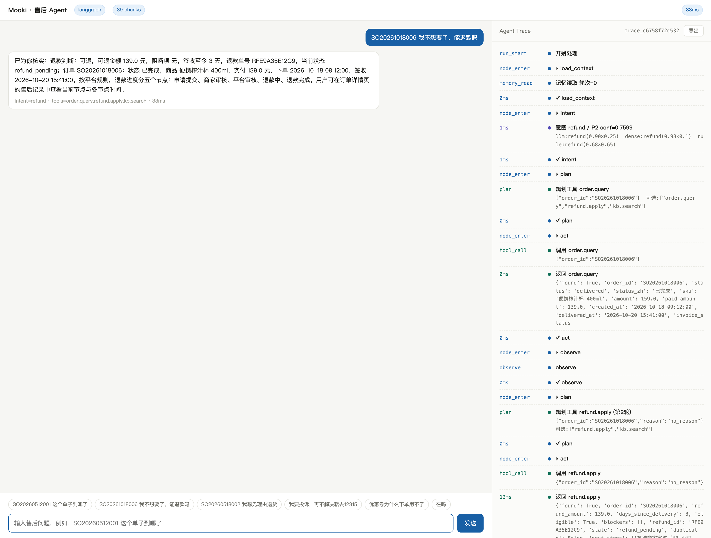
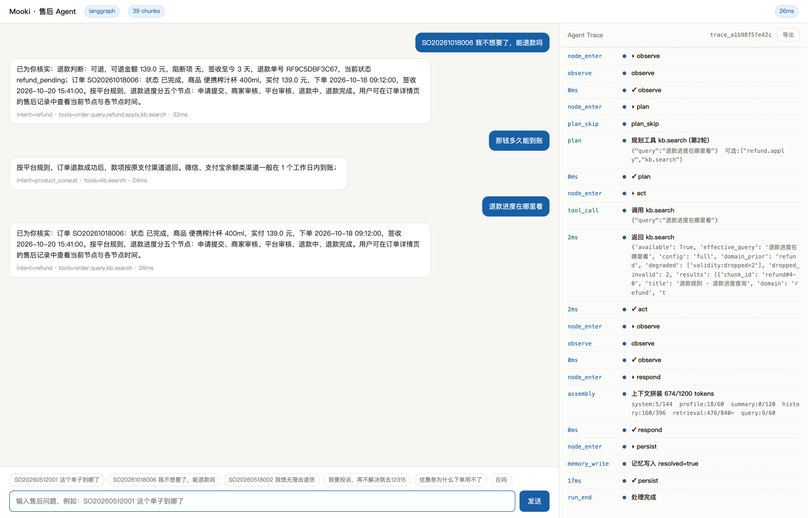
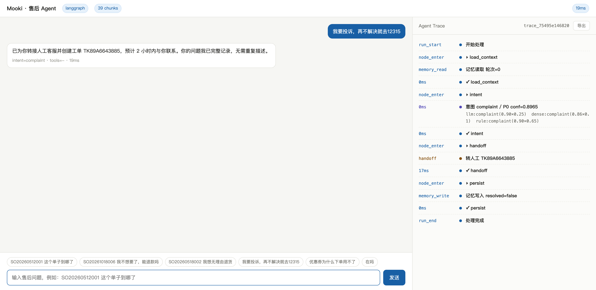

# Mooki

电商售后客服的 Agent。听懂用户在问什么 → 查订单、物流、政策 → 判断这件事能不能办 → 给方案，办不了就转人工。

[](https://github.com/wygxxdm/Mooki/actions/workflows/ci.yml)
[](https://www.python.org/)
[](LICENSE)

一句话：**用一个受控拓扑替代 ReAct，把"模型可能乱来"的地方从流程里挤出去**；重点不在能不能答，
在于每个动作都能在 trace 里复现，效果能被 7 组离线评测量化。



> 左边是对话，右边是这一次 run 的完整轨迹：意图三路投票的每一项分值、规划选了哪个工具、
> 工具返回的原始 JSON、上下文拼装的 token 分布。点"导出"能拿到整个 trace 的 JSON。

<table>
<tr>
<td width="50%"></td>
<td width="50%"></td>
</tr>
<tr>
<td align="center">多轮追问：后两句都不带单号，订单号从结构化槽位继承；<br/>第 3 轮 <code>plan_skip</code> 说明账本已落账，不再重放退款</td>
<td align="center">P0 投诉：跳过意图判断和工具调用，直接建单转人工</td>
</tr>
</table>

复现这几张图：`make serve` 起服务后执行 `node scripts/capture_demo.mjs`（需要 playwright-core
与本地 Chrome；账本状态会影响退款链路，多轮那张建议先重启服务并清空 `data/ledger.jsonl`）。

## 为什么做成"受控"Agent

售后是个挺拧巴的场景。问题高度收敛——用户翻来覆去就问那十来件事；但答错的代价很高，退款金额说错、时效承诺错，都是要赔钱的。

这种场景我不太敢让模型自己决定下一步。ReAct 那种"思考—调用—观察"的循环看着聪明，但它的不确定性恰好落在最不能出错的地方：可能多调一次工具，可能自己编一个金额，也可能在犹豫的时候给用户一个模糊承诺。

所以流程是写死的：

```
load_context → intent → plan → act → observe → respond
                  │       │      │       │
                  ↓       ↓      ↓       ↓
               澄清追问  白名单  熔断   转人工 / 降级
```

模型只有两处自由度：判断用户想干什么（10 类意图 + 4 档紧急度），以及决定调哪个工具、填什么参数。工具从白名单里挑，循环最多 3 轮，P0 级（投诉、12315、资损）直接跳过所有判断送人工。

这条路的代价是灵活性，收益是可预测：任何一个动作都能在 trace 里复现，不需要猜模型当时在想什么。

## 跑起来

```bash
pip install -r requirements.txt
make index      # 建知识库索引（含向量化）
make test       # 59 个单测
make smoke      # 6 条典型链路，看输出
make serve      # http://127.0.0.1:8000
```

打开 `127.0.0.1:8000` 就能聊，右边是实时 trace：每次意图投票的明细、调了哪个工具、检索改写成了什么、上下文用了多少 token，都能点开看原始 JSON。

默认离线模式——LLM 和 embedding 都走本地确定性实现，所以跑测试和评测不需要任何 key。想接真模型，`cp .env.example .env` 填四个字段就够了，业务代码一行不用改：

```bash
MOOKI_LLM_OFFLINE=false
MOOKI_LLM_BASE_URL=https://api.deepseek.com/v1
MOOKI_LLM_API_KEY=sk-xxx
MOOKI_LLM_MODEL=deepseek-chat
```

同一条问题「SO20261018006 我不想要了，能退款吗」在两种模式下的差别：

| 模式 | 回复 | 耗时 |
|---|---|---|
| 离线 | 已为你核实：退款判断：可退，可退金额 139.0 元，阻断项 无，签收至今 2 天 | ~15ms |
| 在线 | 可以退。订单 SO20261018006 的便携榨汁杯已签收 2 天，系统显示可退金额 139.0 元、无阻断项。因已收到货，需走退货退款流程，请先在订单页填写退货物流单号 | ~5.9s |

离线那版是我写的拼接模板，能跑通链路但没法看。**评测和基准强制走离线**，否则模型每次输出都不一样，消融实验就没有意义了。

## 结构

```
mooki/
  core/       配置、LLM 封装、embedding、缓存、熔断、trace、异步写盘
  intent/     意图体系、三路投票分类器、离线 NB 替身
  rag/        切分、BM25、向量库、RRF、改写、有效期校验、检索流水线
  tools/      工具注册表 + 9 个业务工具 + 交易账本
  memory/     短期记忆、情景记忆、用户画像、上下文拼装
  graph/      状态定义、Agent 运行时、LangGraph 图
  api/        FastAPI（同步 / SSE / trace 回放）
  eval/       指标、消融、留出实验、判分
data/kb/      9 个知识域，39 条知识（其中 2 条已过期，用来验证时效过滤）
scripts/      建索引、冒烟、评测、基准
tests/        59 个单测
web/          轨迹面板，单文件
```

图引擎优先用 LangGraph，没装的话自动退回 `graph/mini_graph.py`——同样的节点和边，只是少了 checkpoint 之类的东西。

## 几个设计上的取舍

### 意图为什么要投三次票

单靠 LLM 判意图，遇到"取消订单以后钱退哪去了"这种话会摇摆：订单和退款都沾边，换个说法答案就变了。所以让三路各投一票——LLM、向量近邻、业务关键词——再按权重融合。

三路的量纲完全不一样（类别+置信度 / 余弦相似度 / 命中强度），没法直接平均，投票是唯一能把它们统一起来的形式。冲突太大的时候不硬判，输出 `need_clarify` 让上层追问一句。

权重这里我踩过坑。一开始按"LLM 最强"拍了 0.55，也就是给它最大话语权。后来做留出实验发现，在样本少的情况下 LLM 那一路反而最弱，融合后的准确率 0.35，**比最强的单路 0.85 还低**。改成按 dev 集标定的 `rule 0.65 / llm 0.25 / dense 0.10` 之后才追平。

所以现在配置里那三个权重是量出来的，不是拍的。

### 检索：改写比排序重要

链路是 `改写 → BM25 ∥ 向量 → RRF → 时效过滤 → 去重 → 重排`。

做消融之前我以为重排是最值钱的一环，结果打脸：加改写 R@3 从 0.85 涨到 0.925，加重排 R@5 一点没动，只把 MRR 提了 0.036。

想想也合理。用户说的是"钱怎么还没回来"，知识库里写的是"退款到账时效"，两句话字面几乎不重叠，召回阶段就漏了，重排再准也救不回来。重排解决的是"召回来的几条里谁排第一"，不是"有没有召回来"。

另外一个反直觉的现象：RRF 融合单独用，R@5 是 0.875，比纯 BM25 的 0.900 还低。因为两路质量不等价，等权融合等于用弱的一路稀释强的一路。这也是我后来给权重留了参数的原因。

### 订单号不能靠摘要记

多轮对话里最怕的不是记不住，是"记住了但记错了"。

一开始我用滚动摘要压缩历史，40 轮之后 token 是省了，但订单号 SO20261018006 被摘要抹掉了——后面所有查单工具全部失效，用户得重新说一遍单号。

现在订单号、金额、诉求这些抽成结构化槽位单独存，**不参与压缩**，摘要只压叙述性内容。40 轮会话 token 压掉 79%，订单号保留率 100%。

还踩过一个更蠢的：早期版本在 `append` 里直接 `ltrim` 截断窗口，超出的历史既不进摘要也不留槽位，等于凭空消失。现在折叠只在 `maybe_compress` 里做，因为只有那里拿得到 LLM。

### 退款要能回滚

退款是跨系统操作：平台单改了状态，支付网关那边可能失败。如果本地先改成"退款中"、网关没收到，这笔账就悬空了。

所以订单状态不用 UPDATE，用 append-only 账本：每次只追加一条事实，当前状态由重放推出来。三个东西保证不重复扣钱：

- **状态机**：`paid/shipped/delivered → refund_pending → refunded`，非法转移直接拒
- **幂等键**：重复请求返回第一次的结果，不重新执行
- **补偿**：网关失败时追加一条 `refund.cancel` 把状态回滚

补偿这里也有个坑。回滚要回到"进入退款流程之前"的状态，我一开始取的是上一跳状态，结果 `refund.cancel` 的上一跳就是 `refund_pending`，回滚完还停在退款中，等于没回滚。现在单独记一个 `origin_status`。

## 评测

一共七组实验，`make all` 能全部复现，报告落在 `eval_out/`。

**检索消融**（40 条标注 query，top_k=5）

| 配置 | R@1 | R@3 | R@5 | MRR |
|---|---|---|---|---|
| 纯向量 | 0.550 | 0.800 | 0.825 | 0.673 |
| BM25 | 0.725 | 0.850 | 0.900 | 0.795 |
| +RRF | 0.700 | 0.850 | 0.875 | 0.777 |
| +改写 | 0.725 | 0.925 | 0.950 | 0.823 |
| +重排 | 0.775 | 0.950 | 0.950 | 0.858 |
| +域先验 | 0.800 | 0.950 | 0.950 | 0.867 |

**语料只有 39 条，这个数字不能直接对外说。** 我把 40 条 query 按"query 和目标文档的词汇重叠度"分了三桶，结果不太好看但很有用：

| 重叠度 | n | 纯向量 R@5 | 全链路 R@5 |
|---|---|---|---|
| 低（0-0.18） | 13 | 0.462 | 0.846 |
| 中（0.20-0.33） | 13 | 1.000 | 1.000 |
| 高（0.40-0.71） | 14 | 1.000 | 1.000 |

架构带来的增益全在低重叠那一桶里。也就是说，如果评测集的写法和文档措辞很像（很多项目都是这样），指标会好看得离谱，因为那些样本闭着眼睛也能答对。

还有个更尴尬的数：把 40 条切成 dev/test，全链路在 dev 上 1.000、test 上 0.846，**漂移 0.154，比总体增益 0.125 还大**。所以在这份数据上，配置之间的总体差异落在抽样噪声里，我不拿它当结论。

**意图**

同源评测能到 0.95，但那个数没意义——标注 query 是围绕 exemplar 写的，有两条通道直接在 exemplar 上建库。

按 exemplar 做 5 折留出（每折拿其余样本建库，这一折当查询）之后：

| 通道 | dev | test |
|---|---|---|
| 规则 | 0.800 | 0.850 |
| 向量 | 0.200 | 0.350 |
| 朴素贝叶斯 | 0.267 | 0.300 |
| 融合（未标定权重） | 0.367 | 0.350 |
| 融合（dev 标定权重） | 0.800 | 0.850 |

每折留出后每类只剩 4 条训练样本，属于极端小样本，所以这里只能说明"小样本下规则更稳"，不能反过来推"向量没用"。

**记忆和延迟**：40 轮会话 token 压缩 79%、订单号保留 100%；端到端 P50 6ms / P95 10ms，最大单项是 `persist` 节点（jsonl 同步追加），向量库那部分已经挪到后台线程了。

**规模敏感性**：往索引里注入 468 条近重复变体（同一条知识 × 6 类目 × 2 渠道），从 39 涨到 439 条。全链路相对纯向量的优势在 +0.075 到 -0.025 之间反复横跳，说明近重复知识的词面几乎一样，词法通道也能命中，架构优势会被稀释。

**向量后端**：LSA 0.950 vs 哈希 0.975，小语料上 LSA 反而略差，因为降维把精确词匹配稀释了。两个后端切换只要一条命令，换真实 embedding 服务后重跑 `make embedder` 就知道值不值。

## 踩过的坑

留几个印象深的，都加了测试锁住：

- **SSE 事件发出去前端收不到**。`{"type": "trace_event", **event.model_dump()}`——事件自己也有 `type` 字段，字典展开把外层的覆盖掉了。curl 看服务端一切正常，排查了半天才发现前端一条都没匹配上。
- **LSA 只在知识库上训练，却拿去编码意图样本**。两批文本用词不一样，样本里大量词是 OOV，编码出来接近零向量，向量通道静默退化成"每次都投同一票"。这个 bug 是靠通道消融（`dense_only` 准确率异常）才暴露出来的。
- **评测不幂等**。退款工具改成真的改状态之后，第二次跑评测就命中"已在退款中"，分数每次都变。现在评测和基准都把账本指到临时目录。
- **离线替身和规则通道同源**。两边都在做关键词匹配，投票就成了重复计票。换成朴素贝叶斯之后假设空间才分开。

## 已知问题

- 语料 39 条、query 40 条、端到端 12 条。样本量不够，漂移比大部分配置间差异都大。换真实语料要重跑 `make eval`。
- 离线替身是词袋模型，和真实 LLM 的行为差距很大（同一条 query，真实模型意图置信度 0.89，朴素贝叶斯只有 0.3）。离线数字只能做相对比较。
- 没有真实 embedding 服务，`APIEmbedder` 写好了但没实跑过。
- 账本是单进程加锁，多实例部署要换数据库唯一索引。没做过并发压测。
- 前端是单文件面板，没有鉴权，也没有多会话列表。

## License

还没加 License 文件。要复用的话开个 issue 说一声。
